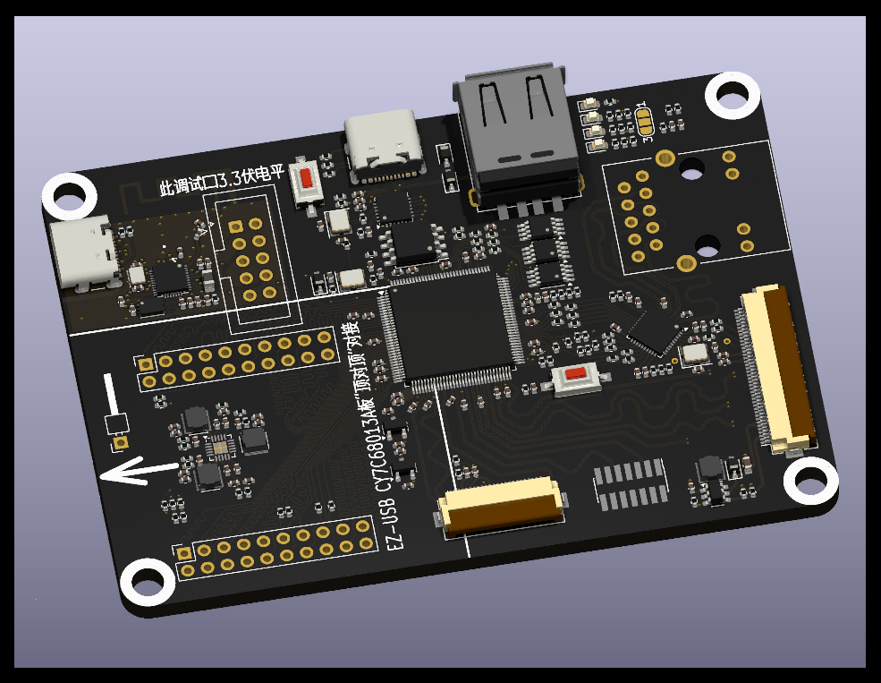

[English](readme.md) | [简体中文](readme.zh-CN.md)

# I. Introduction

**Dalishen Pi** is a truly open-source FPGA development board. From the very
beginning, the project has been developed in the open using Git, publishing
both hardware and software materials, in the hope that like-minded people can
learn FPGA application development together and grow into full-stack
electronics engineers.

At a time when ultra-cheap microcontrollers are everywhere, Dalishen Pi
deliberately avoids simple peripherals and focuses on three application areas:
USB 2.0 High-Speed, RGMII Gigabit Ethernet, and MIPI1. With the
onboard programmer and the USB Sniffer function, the board can be used both as
a development platform and as a tool.

* [1] The hardware interface is reserved; a demo from the FPGA vendor is required.

# II. Key Features

* Programmer and development board in one. After cutting the JTAG-related
  solder jumpers, the programmer can be used standalone. It supports the latest
  version of the Hercules Micro Fuxi toolchain and most of its devices.
* Supports a top-to-top board-to-board connection to a ~CNY 20
  `EZ-USB CY7A68013A` board. After loading the
  `examples/dalishen_pi_h7p20.ataradov.usb_sniffer` firmware, it becomes a
  USB 2.0 protocol analyzer.

# III. Onboard Devices

### [Hercules Micro H7P20N0L128-M3H1](https://hercules-micro.com/index/index/core?id=16)
* 20K logic cells
* LUT6 architecture
* 1152 Kb EMB
* Integrated ARM Cortex-M3 at 268 MHz
* 2304 KB SRAM
* Integrated 128 Mb pSRAM
* LQFP128 package

### [AIC AIC8800FC](https://www.aicsemi.com/)
* Used for the high-speed programmer/debugger
* Reserved external interface, 3.3 V logic level only

### YT8531C
* RGMII Gigabit PHY

### USB3343
* ULPI USB 2.0 High-Speed PHY

# IV. Interfaces

### EZ-USB CY7A68013A board-to-board connector
* Used to connect an EZ-USB CY7A68013A board, about CNY 20
  [purchase link](https://item.taobao.com/item.htm?id=620955124878)

### MIPI DSI 40-pin connector
* Used to connect a 5.0-inch 720x1280 LCD, model `D500C930SV0`, with touch,
  CNY 65 [purchase link](https://item.taobao.com/item.htm?id=707705009617)
* Note: the MIPI interface is currently reserved only and requires future
  development support.

### MIPI CSI 24-pin connector
* Used to connect an OV5640 MIPI camera, part variants `*-23AF`, about CNY 20
  [purchase link](https://item.taobao.com/item.htm?id=816198271497)
* Note: the MIPI interface is currently reserved only and requires future
  development support.

# V. Hardware

* In progress; not yet fabricated or tested.

# VI. Examples

* [Detailed documentation](./examples/readme.md)

# VII. Community

* QQ group: 635683631

# VIII. License

Unless a file or directory contains its own license file or license notice,
the contents of this repository are licensed under the GNU General Public
License v3.0 (GPLv3). See [LICENSE](./LICENSE).

Component licenses:

* `hardware/usb_sniffer_2/`: **GPLv3**. See `hardware/usb_sniffer_2/LICENSE`.
* `examples/usb_sniffer_h7p20.ataradov.usb_sniffer/`: **BSD-3-Clause**.
  See the `LICENSE` file in that directory. Ported from
  [ataradov/usb-sniffer](https://github.com/ataradov/usb-sniffer).
* `examples/dalishen_pi_h7p20.ultraembedded.core_usb_cdc/`: **LGPL-2.1**.
  See the source file headers and `examples/readme.md`.
* Other ports under `examples/` retain their original licenses as listed in
  [`examples/readme.md`](./examples/readme.md).

The USB Sniffer 2 device firmware and host tool are kept in a separate
repository and are licensed under **BSD-3-Clause**:
<https://github.com/vllogic/ataradov.usb-sniffer>
