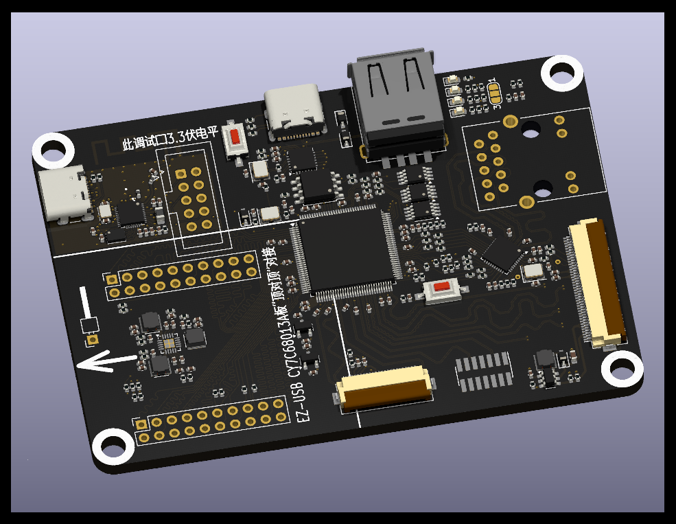

[English](readme.md) | [简体中文](readme.zh-CN.md)

# 一、简介

**大力神派**是一款真●开源的 FPGA 开发板。项目在设计初期即以 Git 的方式公开项目进度及软硬件资料，期待与志同道合的同学们共同掌握 FPGA 应用方法，成长为全栈电子工程师。

在五毛钱单片机大行其道的今天，大力神派完全摒弃简易外设，仅针对 USB 2.0 高速、RGMII 千兆以太网、MIPI1 三个应用方向。通过板载下载器、USB Sniffer 等功能实现开发、工具两用化。

* [1] 硬件接口预留，需 FPGA 原厂提供 Demo。

# 二、特色功能

* 下载器、开发板一体。割断 JTAG 相关短接点后，下载器可独立使用，支持京微齐力最新版本 Fuxi 及其绝大多数芯片。
* 支持顶对顶连接 20 元包邮的 `EZ-USB CY7A68013A 板`，下载 `examples/dalishen_pi_h7p20.ataradov.usb_sniffer` 固件，即可变成 USB 2.0 协议分析仪。

# 三、板载芯片介绍

### [京微齐力 H7P20N0L128-M3H1](https://hercules-micro.com/index/index/core?id=16)
* 20K Logic cells
* LUT6 架构
* 1152Kb EMB
* 内置 ARM Cortex-M3 268MHz 主频
* 2304KB SRAM
* 合封 128Mb pSRAM
* LQFP128 封装

### [爱科微 AIC8800FC](https://www.aicsemi.com/)
* 用于高速下载器/调试器
* 预留对外接口，限定 3.3V 电平

### YT8531C
* RGMII 千兆 PHY

### USB3343
* ULPI USB2.0 高速 PHY

# 四、接口介绍

### EZ-USB CY7A68013A 对接口
* 用于连接 EZ-USB CY7A68013A 板，20 元左右
  [购买链接](https://item.taobao.com/item.htm?id=620955124878)

### MIPI DSI 40P 连接器
* 用于连接 5.0 寸 720x1280 液晶显示屏，型号 `D500C930SV0`，带触摸，65 元
  [购买链接](https://item.taobao.com/item.htm?id=707705009617)
* 注意：MIPI 接口当前仅预留，需后续开发支持。

### MIPI CSI 24P 连接器
* 用于连接 OV5640 MIPI 摄像头，规格 `*-23AF`，20 元左右
  [购买链接](https://item.taobao.com/item.htm?id=816198271497)
* 注意：MIPI 接口当前仅预留，需后续开发支持。

# 五、硬件

* 绘制中，尚未打样及测试。

# 六、例程

* [详细说明](./examples/readme.md)

# 七、交流群

* QQ 群：635683631

# 八、许可证

除非文件或目录自带许可证文件或许可证声明，本仓库内容采用 GNU General Public License v3.0（GPLv3）许可。详见 [LICENSE](./LICENSE)。

组件许可证：

* `hardware/usb_sniffer_2/`：**GPLv3**，见 `hardware/usb_sniffer_2/LICENSE`。
* `examples/usb_sniffer_h7p20.ataradov.usb_sniffer/`：**BSD-3-Clause**，见该目录下的 `LICENSE`。移植自 [ataradov/usb-sniffer](https://github.com/ataradov/usb-sniffer)。
* `examples/dalishen_pi_h7p20.ultraembedded.core_usb_cdc/`：**LGPL-2.1**，见源文件头及 `examples/readme.md`。
* `examples/` 下的其他移植件遵循 [`examples/readme.md`](./examples/readme.md) 中列出的原始许可证。

USB Sniffer 2 的设备固件和主机工具位于独立仓库，采用 **BSD-3-Clause** 许可：<https://github.com/vllogic/ataradov.usb-sniffer>
